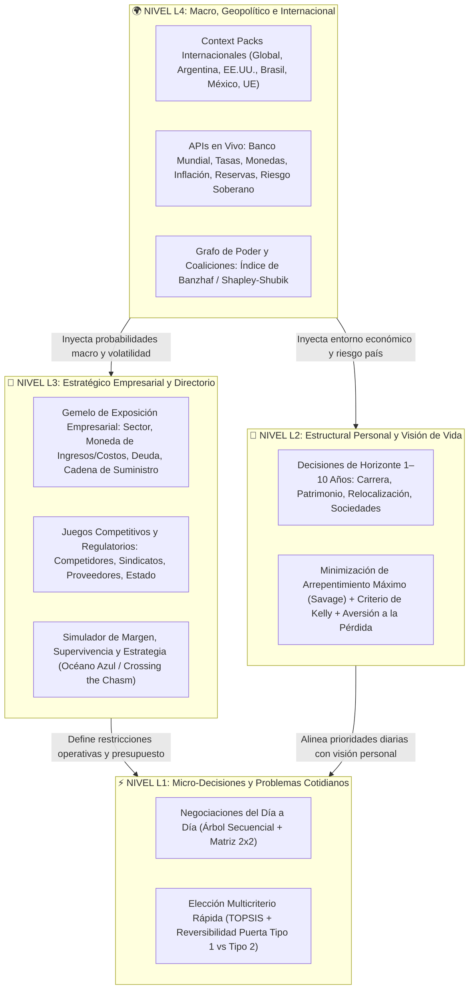

# Informe de Diseño y Arquitectura Estratégica: Sistema Operativo Universal de Decisiones (*Decision OS*)

> **Proyecto:** `MejoraDecisiones` (Autónomo + Preparado para Federación con Ecosistema Mejora)  
> **Fecha:** 2026-11-13  
> **Fundamentación Teórica:** Bibliotecas *Libros* (Estrategia, Poder, Posicionamiento, Producto, DirCom) y *MejoraLibros* (Dinámica de Sistemas, Economía Conductual, DDD, Clean Architecture, Data-Intensive Applications, UX/UI)

---

## 1. Visión y Tesis Central: Autonomía Hoy, Federación Mañana

**MejoraDecisiones** evoluciona desde un tablero político-económico focalizado en Argentina hacia un **Sistema Operativo Universal de Toma de Decisiones, Predicción y Simulación de Escenarios Bajo Incertidumbre (*Decision OS*)** que:

1. **Funciona 100% de manera autónoma (*Standalone-First*):** Cualquier persona, analista, emprendedor o directorio en cualquier lugar del mundo puede usarlo sin depender de servidores externos ni de otras aplicaciones para informarse en tiempo real, modelar conflictos o decisiones, proyectar escenarios mediante algoritmos matemáticos y minimizar su riesgo desde el nivel geopolítico hasta un problema cotidiano.
2. **Está arquitectónicamente preparado para conectarse con el resto del ecosistema (*Federation-Ready*):** A través de un contrato de integración desacoplado (`FederationBridge` / `PostMessage` / `CustomEvents` / `JSON Schema` exportable y URL State), el motor puede inyectar y recibir contexto desde el **Diagnóstico 4D**, **MejoraApp** o cualquier ERP/CRM futuro sin reescribir una sola línea del núcleo matemático.

### La Unidad Matemática de Todas las Decisiones
Siguiendo a **Donella Meadows** (*Thinking in Systems*) y **Eric Evans** (*Domain-Driven Design*), una decisión geopolítica internacional (L4), una decisión estratégica de directorio empresarial (L3), una decisión estructural de vida o carrera (L2) y una decisión táctica o problema cotidiano (L1) comparten exactamente la misma anatomía formal:

- **Actores / Fuerzas:** Agentes con intereses, poder relativo, aversión a la pérdida y capacidad de veto.
- **Alternativas / Estrategias ($D_i$):** Cursos de acción bajo control de quien decide.
- **Estados de la Naturaleza / Escenarios ($S_j$):** Eventos futuros inciertos con probabilidades dinámicas $P(S_j)$.
- **Matriz de Pagos y Exposición ($U_{ij}$):** Consecuencias cuantitativas y cualitativas, asimetría de pérdidas y grado de reversibilidad.
- **Flujo de Evidencia ($E$):** Información entrante de múltiples fuentes y visiones que actualiza las probabilidades previas.

---

## 2. Matriz de Factibilidad Técnica y Diseño Sin Trampas

Siguiendo a **Fred Brooks** (*The Mythical Man-Month*) y **Marty Cagan** (*Inspired*), separamos qué corre de forma determinista/estocástica en el cliente y cómo evitar promesas irreales:

| Capa del Sistema | Factibilidad | Implementación Autónoma en `MejoraDecisiones` | Preparación para Conexión Externa |
| :--- | :---: | :--- | :--- |
| **Motor Matemático y Teoría de Juegos** (Nash Puro/Mixto, IESDS, Árboles Secuenciales, Shapley-Shubik, Banzhaf) | 🟢 **Inmediata (100% Client-Side)** | TypeScript puro en `src/lib/decision-engine/`. Ejecución en `<15ms` en el navegador sin costo de servidor. | Exportable como SDK / paquete NPM o invocable vía `window.MejoraDecisionOS` / `postMessage`. |
| **Motor de Riesgo e Incertidumbre** (Wald Maximin, Savage Minimax Regret, Hurwicz, Prospect Theory de Ariely/Kahneman, Kelly, TOPSIS, Monte Carlo) | 🟢 **Inmediata (100% Client-Side)** | Simulación de Monte Carlo ($10.000$ corridas PERT/Triangular) + matriz multicriterio TOPSIS + filtro de reversibilidad. | Recibe perfiles de empresa desde Diagnóstico 4D / MejoraApp y devuelve vectores de vulnerabilidad y recomendaciones. |
| **Escalado Internacional Multi-País (`ContextPacks`)** | 🟢 **Alta (Inmediata)** | Arquitectura de cartuchos intercambiables (`GLOBAL`, `AR`, `US`, `BR`, `MX`, `EU`) con conectores a **World Bank API**, **BCRA**, **INDEC**, **DolarAPI**, **ExchangeRate/Frankfurter**. | Nuevos países o industrias se enchufan agregando un objeto `ContextPack` sin tocar la UI. |
| **Triangulación de Múltiples Visiones (Consejo de 4 Lentes)** | 🟢 **Alta** | Motor determinista + heurístico de 4 lentes epistémicos (*Maquiavelo/Sun Bin*, *Meadows*, *Ariely*, *Drucker/Osterwalder*) con interfaz lista para conectar cualquier LLM Gateway futuro. | Conector `AIAdapter` listo para enchufar un backend corporativo o API de IA cuando se desee. |
| **Bitácora de Decisiones (*Decision Journal*) y Calibración** | 🟢 **Inmediata** | Persistencia local en `localStorage` / JSON import-export + serialización en URL para compartir escenarios al instante. | Sincronización bidireccional mediante `StorageAdapter` hacia base de datos cloud (Postgres/Supabase/Firebase) en el futuro. |

---

## 3. Arquitectura Fractal de 4 Niveles de Decisión (L4 → L1)

---

## 4. Especificación del Motor Matemático (`src/lib/decision-engine/`)

### 4.1. Teoría de Juegos Extendida
1. **Equilibrios de Nash Puros ($N \times M$) y Mixtos ($2 \times 2$):** Identificación de mejores respuestas mutuas y distribuciones de indiferencia.
2. **Eliminación Iterada de Estrategias Estrictamente Dominadas (IESDS):** Detecta y poda opciones que rinden estrictamente menos que otra alternativa bajo cualquier jugada del oponente.
3. **Juegos Secuenciales en Forma Extensiva (Inducción Hacia Atrás — SPE):**
   $$V(u) = \max_{a \in A(u)} U_{\text{jugador}(u)}(\text{camino óptimo desde } (u, a))$$
   Permite modelar quién mueve primero, cómo responde la contraparte y detectar amenazas vacías (*bluffs*).
4. **Índices de Poder Coalicional (Banzhaf y Shapley-Shubik):**
   Mide el poder real de voto o bloqueo de cada actor en un parlamento, directorio de socios o consorcio según cuántas coaliciones ganadoras se derrumban si ese actor se retira.

### 4.2. Decisión Bajo Incertidumbre y Minimización de Riesgo
Dada una matriz de Alternativas $D_i$ frente a Escenarios $S_j$ con probabilidades $p_j$ y pagos $u_{ij}$:
1. **Valor Esperado (Bayes-Laplace):** $EV(D_i) = \sum_j p_j u_{ij}$
2. **Wald (Maximin — Supervivencia):** $\max_i \min_j u_{ij}$
3. **Savage (Minimax Regret — Mínimo Arrepentimiento):**
   $$R_{ij} = \left(\max_k u_{kj}\right) - u_{ij}, \quad D^* = \arg\min_i \max_j R_{ij}$$
4. **Hurwicz ($\alpha$-Optimismo):** $H(D_i) = \alpha \max_j u_{ij} + (1 - \alpha) \min_j u_{ij}$
5. **Utilidad Prospectiva de Kahneman-Tversky / Dan Ariely (Aversión a la Pérdida):**
   $$v(x) = \begin{cases} x^\alpha & \text{si } x \ge 0 \\ -\lambda (-x)^\beta & \text{si } x < 0 \end{cases} \quad (\lambda \approx 2.25)$$
6. **Criterio de Kelly Acotado (Fracción Óptima sin Ruina):**
   $$f^* = \text{clamp}\left(\frac{p \cdot b - q}{b}, \, 0, \, f_{\max}\right)$$
7. **Simulación de Monte Carlo (Distribución PERT / Triangular):**
   Muestreo estocástico de miles de escenarios para calcular probabilidad de éxito, Valor en Riesgo ($\text{VaR}_{95\%}$), Expected Shortfall ($\text{CVaR}_{95\%}$) y sensibilidad por variable.

### 4.3. Decisión Multicriterio (TOPSIS) + Filtro de Reversibilidad
Para decisiones cotidianas (L1), personales (L2) o de gestión (L3) con múltiples criterios ponderados:
- Calcula la distancia euclidiana ponderada a la solución ideal positiva ($d_i^+$) y negativa ($d_i^-$), entregando un score de cercanía $C_i \in [0, 100\%]$.
- Combina el score con el **Índice de Reversibilidad (Puerta Tipo 1 Irreversible vs. Puerta Tipo 2 Reversible)** y el **Valor Esperado de la Información Perfecta (EVPI)** para recomendar si conviene **ejecutar de inmediato** o **postergar y adquirir información**.

---

## 5. Contrato de Federación para Conexión Futura (`src/lib/federation/`)

Para garantizar que `MejoraDecisiones` funcione hoy como aplicación autónoma y mañana se conecte sin fricción con `MejoraApp`, `Diagnóstico 4D` o suites corporativas:

1. **Estado Portátil y Serializado (`DecisionOSPayload`):** Todo escenario, perfil de empresa, decisión o bitácora cumple un contrato JSON versionado (`version: "1.0"`).
2. **Puente de Eventos (`window.MejoraDecisionOS` + `CustomEvent` + `postMessage`):**
   - Puede recibir el perfil de una empresa diagnosticada en Diagnóstico 4D (`mejora:import-context`).
   - Puede emitir diagnósticos de riesgo, matrices y decisiones tomadas hacia una aplicación padre o hermana (`mejora:decision-committed`).
   - Puede abrirse con parámetros precargados vía URL (`#/decisiones?level=L3&sector=industria...`).

---

## 6. Hoja de Ruta de Construcción Integrada

1. **Núcleo Matemático Unificado (`src/lib/decision-engine.ts`):** Implementar los motores de Riesgo (Wald, Savage, Hurwicz, Prospect Theory, Kelly), Monte Carlo PERT, Multicriterio TOPSIS, Inducción Secuencial, Índice de Banzhaf y Actualización Bayesiana, con suite completa de tests unitarios.
2. **Escalado Internacional y Multi-Visión (`src/lib/context-packs.ts` + `src/lib/api-client.ts`):** Agregar soporte de múltiples regiones/países con datos macro reales del **Banco Mundial (World Bank Open Data API)** + **Frankfurter/DolarAPI/BCRA/INDEC** y el **Consejo de las 4 Lentes Estratégicas** (Maquiavelo, Meadows, Ariely, Drucker).
3. **Laboratorio Universal de Decisiones (`src/pages/Decisiones.tsx`):** Nuevo módulo central interactivo que permite tomar decisiones en las **4 escalas (L4 Macro, L3 Empresa, L2 Personal/Visión, L1 Cotidiano)**, probar escenarios con Monte Carlo, medir el arrepentimiento mínimo y guardar en la **Bitácora de Decisiones** con calibración.
4. **Conexión Reactiva entre Módulos Existentes:**
   - Potenciar `Escenarios.tsx`, `Pymes.tsx`, `Congreso.tsx` y `Internacional.tsx` para que dejen de ser silos estáticos y usen el motor matemático y el estado global compartido.
   - Dejar listo el **Puente de Federación (`src/lib/federation.ts`)** para conectar con el resto del ecosistema Mejora.
